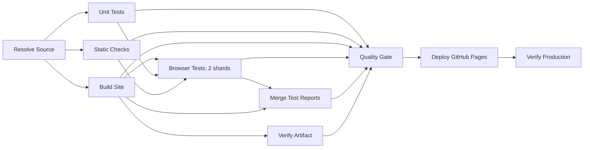

# Portfolio CI/CD

`pages.yml` owns release policy and calls `test-agent-readiness.yml` for quality checks. The workflow name is **Portfolio CI/CD**; job IDs describe dependencies, job names label the Actions UI, step names describe actions, and npm scripts remain usable locally.

## Flow and artifact identity



Static checks and unit tests are independent. Build generates and packages once. Each browser shard and the parallel endpoint check download the same immutable Pages artifact by ID, extract its tar, and validate every file against its manifest. Deploy selects that artifact's unique `pages-<source SHA>` name within the same run. Production verification downloads the same ID again; it never rebuilds the release.

`build-metadata.json` contains schema version, source SHA, a sorted file inventory with size/SHA-256, and SHA-256 of the inventory's JSON representation. Metadata itself is excluded from that inventory, avoiding a self-hash cycle. The uploaded artifact's ID identifies the archive; `contentSha256` identifies its public contents. These values and the deployment URL appear in Actions summaries.

Quality Gate explicitly requires success from every required job, including report merging. Failed, cancelled, skipped, absent or incomplete results fail. Report collection uses `always()` without `continue-on-error`; collecting diagnostics never changes a failed test to success. Bash uses `-e -o pipefail`, including TAP output piped through `tee`.

## Triggers, trust and concurrency

- Main push and main manual runs can publish after the gate. PRs and manual runs on other branches cannot deploy; no `pull_request_target` is used.
- Scheduled/manual data writers have a shared non-cancelling `data-sync` group, main/repository guards and job-scoped contents write. Push triggers were removed to prevent redundant refresh/release chains. GITHUB_TOKEN commits do not trigger push workflows; successful writer completion triggers CI through `workflow_run`.
- The resolver validates the writer name/path pair, originating repository, main branch, schedule/manual event and successful conclusion. `workflow_run.head_sha` predates a writer's later data commit, so it is not used as that commit's identity. Main is resolved once at completion; that exact SHA goes to every downstream checkout. Untrusted workflow artifacts are never imported into deployment.
- All production runs share workflow-level `portfolio-production`, with cancellation disabled. The lock covers quality, deployment and production verification together. This deliberately serializes main CI as well as publication. GitHub concurrency keeps at most one pending run; superseded pending runs may be replaced. A fresh remote-main comparison immediately before deploy rejects old runs. A newer release cannot deploy during the previous release's verification.
- PR/feature CI has separate groups and cancels superseded runs. Branch protection/rulesets are not edited or bypassed. At this change's inspection, the protection API returned unprotected main and the ruleset list was empty; future required-check configurations must use the new job names.

## Browser coverage and performance

Playwright already used `fullyParallel: true` and two workers. These remain. Six Chromium profiles cover three viewports in light/dark themes; they are not six browser engines. Each of two shards runs its assigned subset once on its own Ubuntu runner. Worker contexts/storage and local server ports are isolated; fixtures control third-party services. Retries remain zero, so flaky outcomes cannot silently pass.

Build records all expected test IDs. Each shard records assigned IDs, outcomes, retries, duration and runner resources beside its blob report. The merger requires exactly two reports, one blob per shard and the complete, disjoint expected-test union. Missing, duplicate, skipped, retried and failed tests fail validation. HTML, JUnit and JSON reports are merged; failed shards retain traces, screenshots and video. Reports are retained seven days. Cache keys include OS, architecture, runner generation, project Node version and lockfile hash; OS browser dependencies are still installed.

Baseline run `40496763074` had a 994-second quality job: browser tests 955s, Chromium/OS installation 21s, units 5s, npm install 1s and generation 1s. Overall screenshot duration was 17m09s; quality/deploy/verification consumed 1,020 job-seconds (17 runner-minutes). Browser execution was the measured bottleneck. Duplicate standalone category/excerpt unit workflows were removed; their tests remain in the full unit suite. New run summaries show actual shard and job timings; compare elapsed time and summed runner-minutes, not only the longest job. Queue/cache/network differences prevent a universal speedup claim.

Normal gating remains Chromium. Optional WebKit transition tests are available through `npm run test:motion:webkit`; Firefox and a full cross-engine matrix were not added without evidence of benefit. Neither emulation nor engine testing proves physical-device coverage.

## Runtime and maintenance

Project Node is 22; action runtime is independently Node 24. Actions are pinned to verified full commit SHAs with version comments. The old Node 20 warnings came from direct upload-artifact v4, upload-pages-artifact v4's nested upload, and deploy-pages v4. Their updated action definitions, including Pages upload's nested v7 upload action, use Node 24. No warning-suppression environment variable is used. Weekly Dependabot updates cover npm and GitHub Actions.

Default permission is contents read. Only deployment has Pages/OIDC write. Production reporting adds Actions read for timing evidence. Each job has a timeout; production readiness has a separate two-minute deadline. Static checks parse JS/JSON/YAML and run verified actionlint plus ShellCheck in CI. `npm ci` enforces the committed lockfile.

## Local commands

```powershell
npm ci
npm run lint
npm run test:unit
npx playwright install chromium
npm run build
npm run verify -- --local --artifact --all --output=work/qa/verification-artifact.json
npm run preview
```

`build` runs generation → units → packaging/metadata → browser regression against `.pages-site`. `test:browser` is the source-tree development loop; `test:artifact` validates metadata then tests the packaged output. The former `test:bdd` name was removed: Given/When/Then descriptions help express behavior, but the suite is Playwright browser regression, not a formal BDD framework.

To reproduce shard assignment in PowerShell after packaging:

```powershell
$env:TEST_INVENTORY='work/qa/expected-tests.json'
npx playwright test --list --reporter=./scripts/ci/coverage-reporter.mjs
Remove-Item Env:TEST_INVENTORY
$env:PORTFOLIO_TEST_ROOT='.pages-site'
$env:CI_SHARD='1'
npm run test:browser -- --shard=1/2
$env:CI_SHARD='2'
npm run test:browser -- --shard=2/2
Remove-Item Env:CI_SHARD
```

Local sequential shards avoid conflating one Windows machine's resource limits with separate hosted runners. CI downloads each report into `work/qa/shards/browser-report-N`, runs `node scripts/ci/commands.mjs coverage`, then `npx playwright merge-reports --config=playwright.merge.config.mjs work/qa/all-blob-reports`. Do not use a filtered suite to claim full coverage.

## Production checks and failure handling

The deployment action's `page_url` is the verification target. Readiness checks the expected metadata/source and eight critical files against the tested artifact, including the PDF. A stale `200 OK` is insufficient. Cache-busted requests retry every five seconds within a two-minute deadline; each request is bounded. The existing 112 endpoint checks retain HTTP/MIME/content/PDF coverage.

After readiness, a short browser smoke uses actual production assets and catalogs in desktop/mobile light/dark contexts. It tests Blog/Projects filtering, fixed controls, Contact's fixed heading, Resume navigation, expanded/collapsed Certifications, PDF visibility/access and first-party errors. Hash routes are exercised in the browser because URL fragments are not sent in HTTP requests. Third-party vendor availability is outside this smoke's scope. The full regression suite is not repeated on production.

If quality fails, inspect the failed step, unit TAP, per-shard trace/screenshots and merged report. Missing reports are failures, not permission to skip the gate. Use `npx playwright show-trace <trace.zip>` for browser failures. Rerun failed jobs for a diagnosed environmental failure; rerun all jobs to obtain a fresh complete measurement. Retrying does not erase the original failure evidence. If main advanced, start a new main run rather than publishing a superseded source.

If production verification fails, the workflow fails **after deployment completed**. Inspect readiness expected/actual SHA, file hashes, endpoint report and smoke screenshots. Check CDN propagation and the deployment URL; correct the source and publish a new gated run when needed. No automatic rollback is performed. A manually chosen rollback is a separate release decision, not an implied result of a failed verification.

References: [Playwright sharding](https://playwright.dev/docs/test-sharding), [Pages upload v5](https://github.com/actions/upload-pages-artifact/releases/tag/v5.0.0), [Pages deploy v5.0.1](https://github.com/actions/deploy-pages/releases/tag/v5.0.1).
