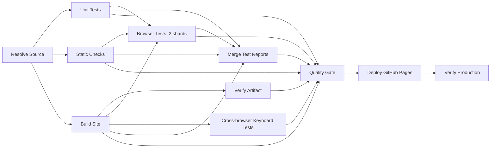

# Portfolio CI/CD

**🇬🇧 English | [🇹🇷 Türkçe](CI-CD.tr.md)**

## Static build identity

The footer shows `Build <runNumber>.<buildAttempt>` and links to the producing
**Portfolio CI/CD** run summary. This is an artifact identity, not SemVer, a count
of successful deployments or a health badge. PRs and failed runs can leave gaps
in the run counter. The existing package version does not change for a deployment.

Packaging validates the caller's GitHub Actions server, repository, workflow and
decimal run identifiers before replacing an artifact. A reusable workflow uses
the caller's GitHub context ([GitHub reference](https://docs.github.com/en/actions/reference/workflows-and-actions/reusing-workflow-configurations#github-context)).
The resolved source SHA still comes from the existing source policy, including
the newer data commit resolved after a trusted synchronization run; the build URL
uses the calling Pages run ID, never the upstream writer ID or the run number.

`packagePages` copies the public inventory, fills one bounded `BUILD-INFO`
insertion point in each portfolio/document shell, then hashes the final bytes.
`build-metadata.json` schema 2 contains `sourceSha`, `contentSha256`, `files` and
`build: {runId, runNumber, buildAttempt, runUrl}`. Run fields are decimal strings
to avoid integer precision loss. Metadata excludes itself from its hash inventory.
Only packaged HTML carries the identity; source HTML and generated Markdown do
not. The five target shells are index, about, contact, privacy and 404. Verification
HTML and every other public file retain their source bytes.

Local packaging without CI context hides the indicator and records `build: null`;
it creates no invented Actions URL. In CI, incomplete or invalid identity is a
packaging error. No browser API request, backend or second version JSON is used.
Cached HTML therefore keeps its own identity even after another run is published.

Artifact names distinguish the producing run and build attempt as well as source
SHA. A new run or rebuilt attempt gets its own immutable artifact. A deploy-only
rerun consumes the original build job's artifact name/ID output and does not
regenerate content or rewrite its identity using the deploy attempt's environment.
The same tested artifact is deployed. Current-source rejection, concurrency,
mandatory checks and production permissions remain unchanged.

Readiness compares the complete manifest, critical asset bytes and the real static
build links on all five shells. The same SHA with an older build identity does not
pass. A successful deploy followed by a failed smoke check still serves the deployed
artifact's identity; the footer makes no automatic claim about run/site health.

`build-version.test.js` and `build-version.spec.mjs` cover this contract, with
deterministic fixture identities, static/no-JS links, native new-tab navigation,
local fallback, reruns, source preservation, two themes, drawer keyboard access,
short/narrow viewports and CSS zoom. Physical devices, screen readers, native
browser-menu zoom and real GitHub rerun execution require separate manual evidence;
automated emulation is not a physical-device result.

`pages.yml` owns release policy and calls `test-agent-readiness.yml` for quality checks. The workflow name is **Portfolio CI/CD**; job IDs describe dependencies, job names label the Actions UI, step names describe actions, and npm scripts remain usable locally.

## Flow and artifact identity



Static checks and unit tests are independent. Build generates and packages once. Each browser shard, the keyboard job and the parallel endpoint check download the same immutable Pages artifact by ID, extract its tar, and validate every file against its manifest. Deploy selects that artifact's unique `pages-<run ID>-<build attempt>-<source SHA>` name within the same run. Production verification downloads the same ID again; it never rebuilds the release.

`build-metadata.json` contains schema version, source SHA, a sorted file inventory with size/SHA-256, and SHA-256 of the inventory's JSON representation. Metadata itself is excluded from that inventory, avoiding a self-hash cycle. The uploaded artifact's ID identifies the archive; `contentSha256` identifies its public contents. These values and the deployment URL appear in Actions summaries.

Quality Gate explicitly requires success from every required job, including report merging. Failed, cancelled, skipped, absent or incomplete results fail. Report collection uses `always()` without `continue-on-error`; collecting diagnostics never changes a failed test to success. Bash uses `-e -o pipefail`, including TAP output piped through `tee`.

## Triggers, trust and concurrency

- Push, pull request, successful writer completion, and a manual run without an input validate without publishing. To publish, run Portfolio CI/CD on `main` with the reviewed 40-character `release_sha`. The selection must equal the main commit attached to the dispatch and the current main ref at deployment time. A mismatch fails without selecting a replacement. The deployment job records the verified SHA in its log and summary.
- A recovery dispatch has no `release_sha`, so it can validate a newer revision without granting publication. A rerun of an explicitly selected release remains bound to its original SHA and must still pass the freshness check.
- Scheduled/manual data writers have a shared non-cancelling `data-sync` group and main/repository guards. Their job token only reads. They never push to main: `scripts/ci/sync-pr.mjs` opens one pull request per source from a fresh `data-sync/<source>-<run>` branch, using the sync GitHub App token (contents and pull requests write only; no ruleset bypass, administration or workflows permission). No change means no PR. Same data on the same main keeps the open PR; otherwise one replacement PR is opened and the old one closed, so a source never has two open sync PRs. Generation that touches a file outside the source's data and generated files fails the sync. Auto-merge is enabled only for the App's own in-scope PR while main requires the Quality Gate from GitHub Actions with up-to-date branches; the merge itself still goes through that required check. Setup and status: `docs/OPEN-ITEMS.md` GOV-1.
- The resolver validates the writer name/path pair, originating repository, main branch, schedule/manual event and successful conclusion. `workflow_run.head_sha` predates a writer's later data commit, so it is not used as that commit's identity. Main is resolved once through the GitHub ref API using the job token with contents read; that exact SHA goes to every downstream checkout. The deployment job uses the same read endpoint to reject superseded releases. Checkout credentials stay nonpersistent.
- **Release recovery rollout.** `recover-release.yml` ships in observe-only mode: it computes the decision, prints it and writes it to the run summary, but acts only when the repository variable `PORTFOLIO_RECOVERY_ACT` is `true` (a manual dispatch never acts). Verified facts: GitHub documents that a `workflow_run` workflow runs from the default branch with a write token ("Last commit on default branch" as `GITHUB_SHA`) and that `workflow_run` chains stop after three levels; this chain is Fetch → Portfolio CI/CD → Recover Release. Phases: (0) merge with the variable unset; (1) dispatch the workflow by hand on past runs (`42043003964`, `42108859656`, `42028696513`) and compare each summary with the expectation in `scripts/tests/deploy-recovery.test.js`; this is the first proof that permissions, Node and `gh` work on a hosted runner; (2) leave observe mode on for several real runs and check that every summary says `none` for green runs and matches the real cause for red ones; (3) set `PORTFOLIO_RECOVERY_ACT=true` (`gh variable set PORTFOLIO_RECOVERY_ACT --body true`); (4) on the first real recovery confirm that the follow-up run starts, that its own completion produces a `none` (attempt 2) summary, and that no third run appears. Rollback: set the variable to `false` or delete the workflow file; the workflow has no `needs` relationship with production, so a failing recovery run never blocks a release. Activation conditions, loop/duplicate/resource analysis and acceptance criteria: [RECOVERY-ACTIVATION.md](RECOVERY-ACTIVATION.md). Open items with priorities and acceptance criteria: [OPEN-ITEMS.md](OPEN-ITEMS.md). Not verifiable before phase 4: whether the completion event of a run started by a `GITHUB_TOKEN` rerun or dispatch reaches `recover-release.yml`; if it does not, the effect is only that attempt 2 is not classified, never a loop.
- **Rollout log (recover-release.yml, observe mode).** Phase 0 done (merged with `PORTFOLIO_RECOVERY_ACT` unset, commit `5ade086`). Phase 1 done on a hosted runner: manual dispatches classified runs `42043003964`, `42108859656` and `42028696513` as `none (A newer run already covers main)`, which is the expected answer because main had moved on. Phase 2, first real event: run `42198985841` (`5ade086`) lost Verify Production to its 10 minute deadline (Chromium installation 550 s, apt mirror stall); `recover-release.yml` run `42204816573` classified it `rerun, performed=false (observe)`, the same decision that was then made by hand: attempt 2 took 19 s for the installation and verified production. The completion of that user-started rerun also triggered `recover-release.yml` (`42205096293`, skipped because the run succeeded), so reruns do reach the follow-up workflow. Still unobserved: a rerun or dispatch started by the workflow itself with `GITHUB_TOKEN`, and phases 3 and 4. Phase 3 (the variable) waits for more observed real events and for the repository owner.
- Release dispatches (`workflow_dispatch` on main, the only event that can deploy) share workflow-level `portfolio-production`, with cancellation disabled. The lock covers quality, deployment and production verification of a release together. Push and data-sync runs on main share a separate `portfolio-main-ci` group, also without cancellation, so a release no longer queues behind main CI (before 2026-11-11 one group served both; dispatch `42866923910` waited 26 minutes behind a push run, and push runs were cancelled by hand to let releases start). GitHub concurrency keeps one running and at most one pending run per group: a newer run replaces the pending one (cancelled before it starts), and a running run is never cancelled. A harmless probe on 2026-11-11 measured exactly that (a 150-second job ran to completion; the pending run was cancelled 12 seconds after it was queued, when a newer one arrived; the newer one started 2 seconds after the running one ended; a job in another group ran alongside). In `portfolio-main-ci` this means a pending push run can be replaced by a data-sync `workflow_run` run, which tests the newer main tip; for example push run `057647f` was replaced by run `43031966255` on the same SHA, so main still got CI. For releases the queue is not the stale check: the release SHA must equal main HEAD at dispatch, and a fresh remote-main comparison immediately before deploy rejects old runs. A newer release cannot deploy during the previous release's verification.
- `recover-release.yml` follows every finished **Portfolio CI/CD** run on main (same repository, `failure` or `cancelled`) with `actions: write` and `contents: read` only; it checks out the default branch, never pull request code. `planRecovery` in `scripts/ci/policy.mjs` is pure and returns one of three answers. **rerun**: the run lost jobs to the job deadline (every cancelled job carries GitHub's "exceeded the maximum execution time" annotation, no other job genuinely failed), it is still the newest main commit and this was attempt 1; `gh run rerun --failed` runs once. **dispatch**: the run was rejected by the "Reject superseded release" step, or lost jobs to a deadline after main had moved on, and no production run exists for the newest commit, so `workflow_dispatch` starts one. **none**: any genuine failure (including a failing test), a manual cancellation without a deadline annotation, an already retried run, or a newest commit that another run already covers. Classification is strict: only `success`, `skipped`, a cancellation, or an aggregate/superseded-deploy failure are benign; any other job conclusion (including `timed_out`) counts as a genuine failure, and one cancelled job without deadline evidence vetoes recovery. A decision is dropped when the run was rerun by someone else in the meantime. A run that never built (every job skipped because a writer failed) does not count as coverage. `workflow_run` production runs carry the data commit that was main when they started as `head_sha` (run `42043003964`: commit `02dc911`, 14:13:53; run created 14:14:01), so comparing `head_sha` with main is valid for every trigger. A real failure is never retried away. Each action ends in a state that the next decision treats as `none`, so the chain cannot loop. Coverage: `scripts/tests/deploy-recovery.test.js`, with fixtures trimmed from real runs `42043003964` (deadline during quality checks), `42108859656` (deadline during Verify Production after a successful deploy) and `42028696513` (superseded). The follow-up run's own `workflow_run` completion event has not yet been observed in production; verify it on the first real recovery.
- PR/feature CI has separate groups and cancels superseded runs. Branch protection/rulesets are not edited or bypassed. At this change's inspection, the protection API returned unprotected main and the ruleset list was empty; future required-check configurations must use the new job names.

## Browser coverage and performance

Playwright already used `fullyParallel: true` and two workers. These remain. Six Chromium profiles cover three viewports in light/dark themes; they are not six browser engines. Each of two shards runs its assigned subset once on its own Ubuntu runner. Worker contexts/storage and local server ports are isolated; fixtures control third-party services. Retries remain zero, so flaky outcomes cannot silently pass.

Build records all expected test IDs. Each shard records assigned IDs, outcomes, retries, duration and runner resources beside its blob report. The merger requires exactly two reports, one blob per shard and the complete, disjoint expected-test union. Missing, duplicate, skipped, retried and failed tests fail validation. HTML, JUnit and JSON reports are merged; failed shards retain traces, screenshots and video. Reports are retained seven days. Cache keys include OS, architecture, runner generation, project Node version and lockfile hash; OS browser dependencies are still installed.

When upstream checks skip the browser jobs, the collector records their results and every missing shard in `browser-coverage-diagnostics`. Coverage still fails. Available blobs are collected independently of coverage validation, so failed or partial runs can still produce diagnostic HTML/JUnit/JSON reports. Merge runs only when a blob exists; merged-report upload runs only when report files exist. No placeholder test reports are created, and the quality gate continues to require every job and both complete, passing shards. `scripts/tests/ci-reports.test.js` covers the report CLI, stale evidence cleanup, invalid reports, upstream diagnostics and workflow conditions.

`scripts/tests/ci-report-flow.test.js` additionally runs a small real Playwright fixture suite without launching browsers. It verifies native blob merging for complete, failed and partial results, failure details in the merged JSON, absent-report diagnostics and nonzero gate exits for missing/failed mandatory jobs. This test reproduces the original missing-first-shard ENOENT on the old collector; it does not replace any browser tests.

Local diagnostics on 2026-11-01 used unchanged tests with Node 22.23.4 and Playwright 1.64.1 on Windows. R-FILTER-10 passed in 16.9 seconds with one worker; four concurrent copies all exhausted the existing 30-second budget. R-KEYBOARD-01 passed alone in 57.2 seconds in Chromium and 64.5 seconds in Firefox, while loaded runs exhausted its 120-second budget. The failed Chromium focus screenshot still showed its outline; the final poll had only 0.9 ms before the overall deadline, rather than a full assertion timeout. These measurements distinguish cumulative command/recording overhead and host contention from a demonstrated focus defect. The workflow uses two workers per isolated Ubuntu runner; running two shards and other browser checks concurrently on one local host is a different load. Single diagnostic passes do not establish a full-suite pass. Browser assertions, timeout/retry values and worker settings remain unchanged; accept changes using the complete PR pipeline for the current head SHA.

R-FILTER-10 is split into four tests, one per Projects category, each covering that category with all 12 Blog category/language cells (still 48 cells, same assertions). The single 48-cell test took 17-25 s unloaded, so any runner slowdown exhausted its 30-second budget; one test now takes about 8 s (max 11 s over 120 unloaded runs). Under a 2-core CPU-starved local load the single test failed 8/8 with `Test timeout of 30000ms exceeded`, the split tests passed 32/32 (max 16.4 s). Timeouts, retries and workers are unchanged.

Baseline run `40496763074` had a 994-second quality job: browser tests 955s, Chromium/OS installation 21s, units 5s, npm install 1s and generation 1s. Overall screenshot duration was 17m09s; quality/deploy/verification consumed 1,020 job-seconds (17 runner-minutes). Browser execution was the measured bottleneck. Duplicate standalone category/excerpt unit workflows were removed; their tests remain in the full unit suite. New run summaries show actual shard and job timings; compare elapsed time and summed runner-minutes, not only the longest job. Queue/cache/network differences prevent a universal speedup claim.

The full Chromium suite remains mandatory. The keyboard audit also requires Firefox and WebKit at desktop/mobile widths in both themes, plus the WebKit touch-arrow matrix. **Cross-browser Keyboard Tests** is an explicit quality-gate dependency and retains its JSON results and failure evidence. It is a two-job matrix, one job per engine (`firefox`, `webkit`; `--project="<engine>-*"`, touch arrows in the WebKit job), with a report artifact per job (`keyboard-browser-report-<engine>`); either job failing fails the gate. As one job it was the run's critical path (25-32 minutes), with each engine needing about half of its time; R-CI-KB-01 checks that the two jobs together run every keyboard project exactly once. These focused checks cover genuine engine differences found during the audit; they do not imply that every existing test runs on every engine. Additional WebKit transition tests remain available through `npm run test:motion:webkit`. See [the keyboard audit](keyboard-accessibility.md) for scope, known local Windows WebKit keyboard settings and manual-testing limits. Neither emulation nor engine testing proves physical-device coverage.

## Runtime and maintenance

Project Node is 22; action runtime is independently Node 24. Actions are pinned to verified full commit SHAs with version comments. The old Node 20 warnings came from direct upload-artifact v4, upload-pages-artifact v4's nested upload, and deploy-pages v4. Their updated action definitions, including Pages upload's nested v7 upload action, use Node 24. No warning-suppression environment variable is used. Weekly Dependabot updates cover npm and GitHub Actions.

Default permission is contents read. Only deployment has Pages/OIDC write. Production reporting adds Actions read for timing evidence. Each job has a timeout; production readiness has a separate two-minute deadline. Static checks parse JS/JSON/YAML and run verified actionlint plus ShellCheck in CI. `npm ci` enforces the committed lockfile.

### Dependency audit gate

Static Checks runs `node scripts/ci/dependency-audit.mjs` after `npm ci`, on every run of the quality workflow (pull request, push, release dispatch and data-sync runs). It audits `package-lock.json` with `npm audit --json --package-lock-only`, so production and development packages are both covered, and reports in the job summary. Exit codes keep the outcomes apart:

| Exit | Result | Meaning | Action |
|---|---|---|---|
| 0 | PASS | Valid report, no high or critical advisory (moderate/low are listed, not blocking) | None |
| 1 | SECURITY FINDING | At least one high or critical advisory | Upgrade the package in its own PR (Dependabot or by hand). Never `npm audit fix --force` inside a CI change |
| 2 | INFRASTRUCTURE ERROR | npm or the registry failed, the output was not a complete, self-consistent report, or the canary was not detected | Re-run when the registry is reachable. This is not a security verdict and not a pass |

npm prints "0 vulnerabilities" when the advisory endpoint answers with an empty object, which is indistinguishable from a clean tree. The gate therefore also audits a fixed canary lockfile (`scripts/ci/audit-canary.json`, minimist 0.0.8, never installed, written to a temporary directory) and accepts a clean result only if the service reports that canary's known critical advisory GHSA-xvch-5gv4-984h. Because the gate runs for release dispatches too, an open high/critical advisory or a registry outage also blocks a release until resolved. Scope limit: vendored browser libraries and remotely loaded scripts are not in `package.json`, so the audit does not see them (see `docs/OPEN-ITEMS.md`, SEC-SCAN).

Both data-sync workflows install from the repository root and cache against `package-lock.json`. The fetchers use Node's built-in `fetch` (supported by the project's Node >=20 requirement), so they need no separate HTTP package or install in `scripts/`. Keep `scripts/package.json`'s ESM boundary: the shared browser helpers in `js/` are also imported as CommonJS by the Medium fetcher.

Medium validates the complete RSS XML with the existing locked `saxes` dependency before extracting articles, so a truncated response containing some complete items cannot replace a valid snapshot. Production browser smoke also compares Blog/Projects card counts with the published JSON datasets, rather than treating a hidden loading indicator as proof of loaded content.

GitHub REST/GraphQL failures fail the sync before any snapshot is replaced, including failures while fetching languages or later starred pages. An empty repositories response is rejected; legitimate empty language maps and starred lists remain supported. `GITHUB_TOKEN` is supplied to the GitHub fetch step for pinned repositories; local public runs without a token retain the existing unpinned mode. Medium keeps its existing optional public-preview/cache fallback and rejects an unusable RSS feed before writing.

Run `node --test scripts/tests/sync-fetchers.test.js` for the focused regression checks (also included in `npm run test:unit`). They spawn both real entry points with native fetch redirected to a local HTTP fixture, covering dependency loading, pagination, filters, credentials, failure exits and unchanged snapshots on upstream errors.

## Report and evidence retention

Pull request, push, data-sync and validation runs keep their reports for 7 days: they are diagnostics for the change under review. A publishing release run keeps the same quality artifacts and its deployed Pages artifact for 90 days (the repository maximum), and `production-verification` is always kept for 90 days, so the bytes, checks and live verification of a release stay inspectable after it. `pages.yml` passes `evidence-retention-days` to the quality workflow; R-CI-02 checks it.

## Local commands

Advertising regressions run in the six Chromium projects and the existing eight
Firefox/WebKit desktop/mobile theme projects. Only the external provider is
simulated; application initialization and the actual scroll panel remain real.
No real-fill/account approval claim follows from those tests. Dynamic In-feed
advertising uses its separately configured account unit; the production-configuration
contract checks its exact attributes, and disabled configuration remains covered.

```powershell
npm ci
npm run lint
npm run test:unit
npx playwright install chromium
npm run build
npm run verify -- --local --artifact --all --output=work/qa/verification-artifact.json
npm run preview
```

For the additional mandatory keyboard/touch checks, install Firefox and WebKit with `npx playwright install firefox webkit`, then run `npx playwright test --config=playwright.keyboard.config.mjs` and `npx playwright test --config=playwright.webkit.config.mjs tests/browser/arrow-controls.spec.mjs`. CI additionally installs their Linux system dependencies and sets `PORTFOLIO_TEST_ROOT=.pages-site` so these checks exercise the verified artifact.

`build` runs generation → units → packaging/metadata → browser regression against `.pages-site`. `test:browser` is the source-tree development loop; `test:artifact` validates metadata then tests the packaged output. The former `test:bdd` name was removed: Given/When/Then descriptions help express behavior, but the suite is Playwright browser regression, not a formal BDD framework.

## Investigating failures and rerunning

Open the failed run and identify its resolved source SHA before comparing results. Unit TAP, each shard's blob/results/traces, merged HTML/JUnit reports and artifact verification are retained as named run artifacts. Inspect the failing assertion or request, fix its cause, and run the affected check locally; the resulting source revision must pass the complete quality gate. Do not change assertions, skip tests or reuse reports from another run to make the gate green. In Actions, a rerun uses that run's original revision; changes require a new run. If main advanced, publish the new main revision rather than redeploying the superseded source.

A failed **Verify Production** after a successful deployment means the site was deployed but is not verified; no automatic rollback has occurred. Inspect `production-verification` for bounded readiness attempts, expected/actual release metadata, endpoint failures, browser results and failure screenshots/traces. Compare the tested artifact ID, manifest source SHA and content hash with the live `build-metadata.json`. For a transient verification failure, rerun on the same still-current SHA; for a code/data failure, fix it and pass a fresh quality/deployment/production run. Keep the production concurrency lock intact throughout.

To reproduce shard assignment in PowerShell after packaging:

```powershell
$env:TEST_INVENTORY='work/qa/expected-tests.json'
npx playwright test --list --reporter=./scripts/ci/coverage-reporter.mjs
Remove-Item Env:TEST_INVENTORY
$env:PORTFOLIO_TEST_ROOT='.pages-site'
$env:CI_SHARD='1'
npm run test:browser -- --shard=1/2
$env:CI_SHARD='2'
npm run test:browser -- --shard=2/2
Remove-Item Env:CI_SHARD
```

Local sequential shards avoid conflating one Windows machine's resource limits with separate hosted runners. CI downloads each report into `work/qa/shards/browser-report-N`, runs `node scripts/ci/commands.mjs coverage`, then `npx playwright merge-reports --config=playwright.merge.config.mjs work/qa/all-blob-reports`. Do not use a filtered suite to claim full coverage.

## Production checks and failure handling

The deployment action's `page_url` is the verification target. Readiness checks the expected metadata/source, manifest-listed critical assets and all five build-bearing HTML shells against the tested artifact, including the shared keyboard stylesheet, site shell and PDF. A stale `200 OK` is insufficient. Cache-busted requests retry every five seconds within a two-minute deadline; each request is bounded. The existing endpoint checks retain HTTP/MIME/content/PDF coverage.

After readiness, a short browser smoke uses actual production assets and catalogs in desktop/mobile light/dark contexts. It tests Blog/Projects filtering, fixed controls, Contact's fixed heading, Resume navigation, expanded/collapsed Certifications, PDF visibility/access and first-party errors. Actual Tab/Shift+Tab, Enter and Space verify initial Resume controls, Contact link focus boxes and arrow reachability/retained focus; touch-enabled mobile contexts also check restored arrow color. Hash routes are exercised in the browser because URL fragments are not sent in HTTP requests. Third-party vendor availability is outside this smoke's scope. The full regression suite is not repeated on production.

If quality fails, inspect the failed step, unit TAP, per-shard trace/screenshots and merged report. Missing reports are failures, not permission to skip the gate. Use `npx playwright show-trace <trace.zip>` for browser failures. Rerun failed jobs for a diagnosed environmental failure; rerun all jobs to obtain a fresh complete measurement. Retrying does not erase the original failure evidence. If main advanced, start a new main run rather than publishing a superseded source.

If production verification fails, the workflow fails **after deployment completed**. Inspect readiness expected/actual SHA, file hashes, endpoint report and smoke screenshots. Check CDN propagation and the deployment URL; correct the source and publish a new gated run when needed. No automatic rollback is performed. A manually chosen rollback is a separate release decision, not an implied result of a failed verification.

References: [Playwright sharding](https://playwright.dev/docs/test-sharding), [Pages upload v5](https://github.com/actions/upload-pages-artifact/releases/tag/v5.0.0), [Pages deploy v5.0.1](https://github.com/actions/deploy-pages/releases/tag/v5.0.1).

## Browser installation stalls (apt mirror)

`npx playwright install --with-deps` downloads its system packages through apt on every run (about 21 MB for Chromium, 114 MB for Firefox and WebKit). Across 130 completed installation steps the median was 14 seconds and 128 finished within 108 seconds. The slow cases seen so far, all with the same cause (the hosted Azure Ubuntu mirror, `azure.archive.ubuntu.com`, degrading), come in two different shapes:

1. **Idle stalls**: run `42108859656` took 474 s (Browser Tests 1/2, passed) and 585 s (Verify Production, cancelled by its 10 minute deadline). The log shows the mirror stopping mid-download, apt waiting its default 120 s idle timeout, printing `Ign:` and retrying, about four times.
2. **Throughput collapse**: in pull request runs `42169381575` and `42169563198` (started within a minute of each other) the step "Install keyboard test browsers" ran 3007 s until the 50 minute job deadline cancelled the job. The mirror never went idle: a 7.5 MB package took about 3 minutes and 54 of the packages needed 16 minutes, with only one `Ign:`. Cancelled steps have no end time, so these two are not part of the 130.

Three further jobs lost the same 50 minutes: pull request run `42195056397` (the jQuery PR; 20 of about 54 packages in 50 minutes) and `42195218463`, plus the pair above. Healthy installation steps (37 keyboard, 93 Chromium) finished within 108 seconds. Two mitigations are in place, and each covers a different part of the problem:

- `scripts/ci/bound-apt-network.sh` lowers apt's idle timeout to 20 s with three retries before each installation. **Observed effective values differ (2026-11-07):** `apt-config dump` in 8 of 8 sampled jobs printed `Timeout "15"` and `Retries "1"`, so another configuration source overrides the script's values (source found: the runner's `/etc/apt/apt.conf.d/zz-retries` sorts after the script's `99-ci-network` and wins; see APT-MIRROR-OPTIONS.md); see [APT-MIRROR-OPTIONS.md](APT-MIRROR-OPTIONS.md) section 1. That fixes shape 1 only; it does not change shape 2, because data keeps arriving slowly and never trips an idle timeout.
- Every installation step has `timeout-minutes: 5` (2.8 times the slowest healthy step). A degraded mirror now costs five minutes instead of the 50 minute job deadline. The step fails instead of being cancelled, and `planRecovery` treats a failed job as infrastructure when its annotation says `has timed out after N minutes` (all other failures stay genuine), so on main the failed job is rerun once on a fresh runner, which usually lands on a healthy mirror. On a pull request nothing reruns automatically: use "Re-run failed jobs".

**Update 2026-11-11 (third shape, DNS failure):** the runners could not resolve `azure.archive.ubuntu.com` for hours. The main push run `43033608440` and pull request runs `43034281844`, `43035186941` and `43040117023` (four attempts) all failed in the installation step before any browser test ran, and reruns did not help until the mirror resolved again around 16:54 UTC (#75 run `43035186941`, attempt 3). At 17:01 UTC the main push run `43064099228` still lost Browser Tests 1/2 to the five-minute installation deadline. By the owner's decision, **Browser Tests** and **Cross-browser Keyboard Tests** now run in the official Playwright container image (`mcr.microsoft.com/playwright:v1.65.0-noble`, pinned by digest), which holds the browsers and their system packages, so these jobs download nothing through apt. `scripts/ci/check-container-browsers.mjs` fails the job early if the image and the locked Playwright version differ, and `R-CI-PWC-01/02` check the tag, the digest and that no install step remains. **Verify Production** (`pages.yml`) runs in the same image since 2026-11-12; a pull request run cannot exercise that job, so its first real run is the next production dispatch (not verified until then). When `@playwright/test` is upgraded, change the image tag to the same version and replace the digest in all three jobs (`docker buildx imagetools inspect mcr.microsoft.com/playwright:v<version>-noble` prints it); `R-CI-PWC-01` fails until the tag matches. Dependabot does not update this image. Not proven: that the image registry is more reliable than the mirror. No job installs browsers through apt any more. The text below is the record of the apt path and of the mitigations (`bound-apt-network.sh`, the five-minute step deadline) that any future installation step must keep (`R-CI-APT-01`).

Comparison of the options and the recommendation: [APT-MIRROR-OPTIONS.md](APT-MIRROR-OPTIONS.md). The container image option is applied to the browser and keyboard jobs (update above). Options still not applied, because each changes the job architecture or rests on unmeasured behavior: cache apt's archive directory, or fail over to a second mirror. `scripts/tests/apt-network-bounds.test.js` checks that every installation step has the bound and the deadline. Observed: the first pull request run with the deadline (`42205318156`) failed Browser Tests 1/2 after exactly five minutes with the annotation `The action 'Install Chromium dependencies' has timed out after 5 minutes.`, the text `planRecovery` matches (the other jobs of that run finished normally, so the stall cost five minutes, not fifty). Not proven: whether a rerun lands on a healthy mirror in every case (one real rerun, run `42198985841`, did: 550 s then 19 s), and the full path on main, which needs a real occurrence. Confirm from future installation-step durations (expect a 14 s median and no step above about 2 minutes). Job deadlines were not changed in this change.

## Occasional focus failures (R-FILTER-04, R-KEYBOARD-08)

Both tests failed once each in CI on `small-mobile-*` and passed on rerun: `R-FILTER-04` in runs of PR #27 and of `c34fa04` (the Blog language toggle kept `aria-pressed="true"` on `en` after the test pressed `all`), and `R-KEYBOARD-08` in `6342ab6` (the first Blog language button did not receive focus). The application code of `6342ab6` equals the previous green run; the first `R-FILTER-04` failure predates jQuery 3.

What was checked: the language buttons are static markup and `curLang` is only written by `setBlogLang`, so a desynchronised state cannot explain it; focus is moved to a page heading only at the end of the animation, which `expectSection` waits for; the drawer restores focus synchronously. What was run: 60 local repetitions of `R-KEYBOARD-08` on the jQuery 3 build (30 plain, 30 with two busy processes and four workers), 30 of `R-FILTER-04` with 4x and 50 with 12x CPU throttling: no failure. The trace, video and screenshot of the CI failures are artifacts that this sandbox cannot download, so the cause is **unproven**. No test was loosened or retried.

To make the next occurrence decisive, `tests/browser/helpers/focus-diagnostics.mjs` appends the page state at failure (active element, current and inert pages, drawer state, hash) to the focus and language-toggle assertions. If a failure shows an unexpected active element, the cause is a focus move; if it shows a different current page or an open drawer, it is a routing race.

