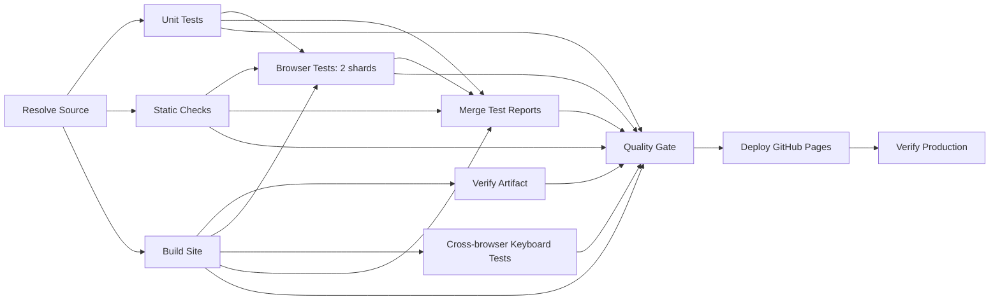

# Portfolio CI/CD

**[🇬🇧 English](CI-CD.md) | 🇹🇷 Türkçe**

## Statik build kimliği

Footer, `Build <runNumber>.<buildAttempt>` bilgisini gösterir ve bu build'i üreten
**Portfolio CI/CD** koşusunun özetine bağlantı verir. Bu bir artifact kimliğidir; SemVer,
başarılı yayın sayısı veya sağlık rozeti değildir. PR'lar ve başarısız koşular koşu
sayacında boşluk bırakabilir. Mevcut paket sürümü yayınla birlikte değişmez.

Paketleme, bir artifact'i değiştirmeden önce çağıran tarafın GitHub Actions sunucusunu,
deposunu, workflow'unu ve ondalık koşu kimliklerini doğrular. Yeniden kullanılabilir bir
workflow, çağıranın GitHub bağlamını kullanır
([GitHub referansı](https://docs.github.com/en/actions/reference/workflows-and-actions/reusing-workflow-configurations#github-context)).
Çözümlenen kaynak SHA'sı yine mevcut kaynak politikasından gelir; buna güvenilir bir
senkronizasyon koşusundan sonra çözümlenen daha yeni veri commit'i de dahildir. Build
URL'si, üst kaynaktaki yazıcının kimliğini veya koşu numarasını değil, her zaman çağıran
Pages koşusunun kimliğini kullanır.

`packagePages`, herkese açık envanteri kopyalar, her portföy/belge kabuğundaki sınırlı tek
`BUILD-INFO` ekleme noktasını doldurur, ardından son baytların hash'ini alır.
`build-metadata.json` şema 2; `sourceSha`, `contentSha256`, `files` ve
`build: {runId, runNumber, buildAttempt, runUrl}` alanlarını içerir. Tam sayı hassasiyet
kaybını önlemek için koşu alanları ondalık metin olarak tutulur. Metadata kendisini hash
envanterinin dışında bırakır. Kimliği yalnızca paketlenmiş HTML taşır; kaynak HTML ve
üretilen Markdown taşımaz. Hedef beş kabuk index, about, contact, privacy ve 404'tür.
Doğrulama HTML'i ve diğer tüm herkese açık dosyalar kaynak baytlarını korur.

CI bağlamı olmadan yerelde yapılan paketleme göstergeyi gizler ve `build: null` kaydeder;
uydurma bir Actions URL'si üretmez. CI'da eksik veya geçersiz kimlik bir paketleme
hatasıdır. Tarayıcıdan API isteği, backend veya ikinci bir sürüm JSON'u kullanılmaz. Bu
nedenle önbellekteki HTML, başka bir koşu yayınlandıktan sonra bile kendi kimliğini korur.

Artifact adları kaynak SHA'sının yanı sıra üreten koşuyu ve build denemesini de ayırt eder.
Yeni bir koşu veya yeniden yapılan bir deneme kendi değişmez artifact'ini alır. Yalnızca
deploy'u yeniden çalıştıran bir koşu, orijinal build job'unun artifact adı/kimliği çıktısını
kullanır; içeriği yeniden üretmez ve kimliği deploy denemesinin ortamına göre yeniden
yazmaz. Yayınlanan, test edilen artifact'in aynısıdır. Güncel kaynak reddi, concurrency,
zorunlu kontroller ve canlı ortam izinleri değişmeden kalır.

Hazırlık kontrolü tam manifest'i, kritik asset baytlarını ve beş kabuğun hepsindeki gerçek
statik build bağlantılarını karşılaştırır. Aynı SHA'nın daha eski bir build kimliği
kontrolü geçemez. Başarılı bir yayından sonra smoke kontrolü başarısız olursa site yine
yayınlanan artifact'in kimliğini sunar; footer koşunun veya sitenin sağlığı hakkında
otomatik bir iddiada bulunmaz.

Bu sözleşmeyi `build-version.test.js` ve `build-version.spec.mjs` kapsar: deterministik
fixture kimlikleri, statik/JS'siz bağlantılar, yeni sekmede yerel gezinme, yerel yedek
davranış, yeniden çalıştırmalar, kaynağın korunması, iki tema, çekmecede klavye erişimi,
kısa/dar görünüm alanları ve CSS zoom. Fiziksel cihazlar, ekran okuyucular, tarayıcı
menüsünden yapılan zoom ve GitHub'da gerçek yeniden çalıştırma ayrı manuel kanıt gerektirir;
otomatik emülasyon fiziksel cihaz sonucu değildir.

Yayın politikası `pages.yml`'dedir; kalite kontrolleri için `test-agent-readiness.yml`
çağrılır. Workflow'un adı **Portfolio CI/CD**'dir; job kimlikleri bağımlılıkları, job adları
Actions arayüzündeki etiketleri, adım adları yapılan işi tanımlar; npm betikleri yerelde de
kullanılabilir.

## Akış ve artifact kimliği



Statik kontroller ve birim testleri birbirinden bağımsızdır. Build, üretimi ve paketlemeyi
bir kez yapar. Her tarayıcı shard'ı, klavye job'u ve paralel uç nokta kontrolü aynı
değişmez Pages artifact'ini kimliğiyle indirir, tar arşivini açar ve her dosyayı
manifest'ine göre doğrular. Deploy, aynı koşu içinde o artifact'in benzersiz
`pages-<run ID>-<build attempt>-<source SHA>` adını seçer. Canlı doğrulama aynı kimliği
yeniden indirir; yayını asla yeniden build etmez.

`build-metadata.json`; şema sürümünü, kaynak SHA'sını, boyut/SHA-256 bilgisiyle sıralı bir
dosya envanterini ve envanterin JSON gösteriminin SHA-256 değerini içerir. Kendi kendini
hash'leme döngüsünü önlemek için metadata bu envanterin dışındadır. Yüklenen artifact'in
kimliği arşivi, `contentSha256` ise herkese açık içeriğini tanımlar. Bu değerler ve yayın
URL'si Actions özetlerinde görünür.

Quality Gate, rapor birleştirme dahil her zorunlu job'un başarılı olmasını açıkça şart
koşar. Başarısız, iptal edilmiş, atlanmış, eksik veya tamamlanmamış sonuçlar kapıyı
kırar. Rapor toplama `continue-on-error` olmadan `always()` kullanır; teşhis bilgisi
toplamak başarısız bir testi asla başarılıya çevirmez. Bash, `tee` üzerinden aktarılan TAP
çıktısı dahil `-e -o pipefail` ile çalışır.

## Tetikleyiciler, güven ve concurrency

- Push, pull request, başarılı bir veri yazıcısının tamamlanması ve girdisiz manuel koşu
  yalnızca doğrulama yapar, yayınlamaz. Yayınlamak için Portfolio CI/CD, `main` üzerinde
  incelenmiş 40 karakterlik `release_sha` ile çalıştırılır. Seçilen SHA, dispatch'e bağlı
  main commit'ine ve yayın anındaki güncel main ref'ine eşit olmalıdır. Uyuşmazlık, yerine
  başka bir SHA seçmeden başarısız olur. Deploy job'u doğrulanan SHA'yı günlüğüne ve
  özetine yazar.
- Kurtarma amaçlı bir dispatch'in `release_sha`'sı yoktur; böylece daha yeni bir revizyonu
  yayın yetkisi vermeden doğrulayabilir. Açıkça seçilmiş bir yayının yeniden çalıştırılması
  orijinal SHA'sına bağlı kalır ve yine güncellik kontrolünden geçmelidir.
- Zamanlanmış/manuel veri yazıcıları iptal etmeyen ortak bir `data-sync` grubunu ve main/depo
  korumalarını paylaşır. Job token'ları yalnızca okur. Main'e asla push etmezler:
  `scripts/ci/sync-pr.mjs`, senkronizasyon GitHub App token'ıyla (yalnızca contents ve pull
  requests yazma; ruleset bypass, administration veya workflows izni yok) her kaynak için
  güncel main'den açılan `data-sync/<kaynak>-<koşu>` dalından bir pull request açar. Değişiklik
  yoksa PR açılmaz. Aynı main üzerinde aynı veri varsa açık PR korunur; aksi hâlde tek bir
  yeni PR açılır ve eskisi kapatılır, böylece bir kaynağın iki açık senkronizasyon PR'ı olmaz.
  Kaynağın verisi ve ondan üretilen dosyalar dışında bir dosyaya dokunan üretim senkronizasyonu
  başarısız kılar. Auto-merge yalnızca App'in kendi kapsam içi PR'ı için ve main, GitHub
  Actions'tan gelen Quality Gate'i güncel dal koşuluyla zorunlu tuttuğu sürece etkinleşir;
  merge'ün kendisi yine bu zorunlu kontrolden geçer. Kurulum ve durum: `docs/OPEN-ITEMS.md` GOV-1.
- Çözümleyici; yazıcının ad/yol çiftini, kaynak depoyu, main dalını, schedule/manual
  olayını ve başarılı sonucu doğrular. `workflow_run.head_sha`, yazıcının sonraki veri
  commit'inden öncesine ait olduğundan o commit'in kimliği olarak kullanılmaz. Main, job
  token'ı ve contents read izniyle GitHub ref API'si üzerinden bir kez çözümlenir; bu SHA
  sonraki her checkout'a aktarılır. Deploy job'u, yerine yenisi gelmiş yayınları reddetmek
  için aynı okuma uç noktasını kullanır. Checkout kimlik bilgileri kalıcı tutulmaz.
- **Yayın kurtarmasının devreye alınması.** `recover-release.yml` yalnızca gözlem modunda
  gelir: kararı hesaplar, yazdırır ve koşu özetine yazar; ancak yalnızca depo değişkeni
  `PORTFOLIO_RECOVERY_ACT` `true` olduğunda işlem yapar (manuel dispatch asla işlem yapmaz).
  Doğrulanmış bilgiler: GitHub, bir `workflow_run` workflow'unun varsayılan daldan yazma
  token'ıyla çalıştığını (`GITHUB_SHA` olarak "Last commit on default branch") ve
  `workflow_run` zincirlerinin üç seviyeden sonra durduğunu belgeler; buradaki zincir
  Fetch → Portfolio CI/CD → Recover Release'tir. Aşamalar: (0) değişken tanımsızken
  birleştirme; (1) workflow'u geçmiş koşular (`42043003964`, `42108859656`, `42028696513`)
  üzerinde elle çalıştırmak ve her özeti `scripts/tests/deploy-recovery.test.js` içindeki
  beklentiyle karşılaştırmak; izinlerin, Node'un ve `gh`'nin hosted runner üzerinde
  çalıştığının ilk kanıtı budur; (2) gözlem modunu birkaç gerçek koşu boyunca açık bırakmak
  ve her özetin yeşil koşular için `none`, kırmızılar için gerçek nedenle eşleşen sonucu
  verdiğini kontrol etmek; (3) `PORTFOLIO_RECOVERY_ACT=true` ayarlamak
  (`gh variable set PORTFOLIO_RECOVERY_ACT --body true`); (4) ilk gerçek kurtarmada takip
  koşusunun başladığını, kendi tamamlanmasının `none` (deneme 2) özeti ürettiğini ve üçüncü
  bir koşu oluşmadığını doğrulamak. Geri alma: değişkeni `false` yapmak veya workflow
  dosyasını silmek; workflow'un canlı ortamla `needs` ilişkisi yoktur, bu yüzden başarısız
  bir kurtarma koşusu yayını asla engellemez. Etkinleştirme koşulları, döngü/mükerrerlik/
  kaynak analizi ve kabul ölçütleri: [RECOVERY-ACTIVATION.md](RECOVERY-ACTIVATION.md)
  (İngilizce). Öncelik ve kabul ölçütleriyle açık maddeler: [OPEN-ITEMS.md](OPEN-ITEMS.md)
  (İngilizce). 4. aşamadan önce doğrulanamayan: `GITHUB_TOKEN` ile başlatılan bir yeniden
  çalıştırma veya dispatch koşusunun tamamlanma olayının `recover-release.yml`'e ulaşıp
  ulaşmadığı; ulaşmazsa tek etkisi 2. denemenin sınıflandırılmamasıdır, asla bir döngü
  değildir.
- **Devreye alma günlüğü (recover-release.yml, gözlem modu).** 0. aşama tamamlandı
  (`PORTFOLIO_RECOVERY_ACT` tanımsızken birleştirildi, commit `5ade086`). 1. aşama hosted
  runner üzerinde tamamlandı: manuel dispatch'ler `42043003964`, `42108859656` ve
  `42028696513` koşularını `none (A newer run already covers main)` olarak sınıflandırdı;
  main ilerlemiş olduğu için beklenen cevap budur. 2. aşamada ilk gerçek olay: `42198985841`
  koşusu (`5ade086`), Verify Production adımını 10 dakikalık süre sınırına kaybetti
  (Chromium kurulumu 550 sn, apt mirror takılması); `recover-release.yml` koşusu
  `42204816573` bunu `rerun, performed=false (observe)` olarak sınıflandırdı; bu, sonra elle
  verilen kararın aynısıydı: 2. deneme kurulumu 19 sn'de bitirdi ve canlı ortamı doğruladı.
  Kullanıcının başlattığı bu yeniden çalıştırmanın tamamlanması da `recover-release.yml`'i
  tetikledi (`42205096293`; koşu başarılı olduğu için atlandı), yani yeniden çalıştırmalar
  takip workflow'una ulaşıyor. Henüz gözlemlenmeyenler: workflow'un kendisinin `GITHUB_TOKEN`
  ile başlattığı bir yeniden çalıştırma veya dispatch, ve 3. ile 4. aşamalar. 3. aşama
  (değişken), daha fazla gerçek olay gözlemlenmesini ve depo sahibini bekliyor.
- Yayın dispatch'leri (main üzerinde `workflow_dispatch`, deploy edebilen tek olay), iptali
  kapalı workflow düzeyindeki `portfolio-production` grubunu paylaşır. Kilit bir yayının
  kalite, deploy ve canlı doğrulamasını birlikte kapsar. Main üzerindeki push ve veri
  senkronizasyonu koşuları yine iptalsiz, ayrı `portfolio-main-ci` grubunu paylaşır; böylece
  yayın artık main CI'ının arkasında beklemez (2026-11-11 öncesinde ikisi tek gruptaydı;
  dispatch `42866923910` bir push koşusunun arkasında 26 dakika bekledi, yayınların başlaması
  için push koşuları elle iptal edildi). GitHub concurrency en fazla bir bekleyen koşu
  tutar; yerine yenisi gelen bekleyen koşular değiştirilebilir. Deploy'dan hemen önce yapılan
  güncel uzak main karşılaştırması eski koşuları reddeder. Önceki yayının doğrulaması
  sürerken daha yeni bir yayın deploy edilemez.
- `recover-release.yml`, main üzerinde biten her **Portfolio CI/CD** koşusunu (aynı depo,
  `failure` veya `cancelled`) yalnızca `actions: write` ve `contents: read` izinleriyle takip
  eder; varsayılan dalı checkout eder, asla pull request kodunu değil. `scripts/ci/policy.mjs`
  içindeki `planRecovery` saf bir fonksiyondur ve üç cevaptan birini döndürür. **rerun**:
  koşu job'larını süre sınırına kaybetmiştir (iptal edilen her job GitHub'ın "exceeded the
  maximum execution time" notunu taşır, başka hiçbir job gerçekten başarısız olmamıştır),
  hâlâ en yeni main commit'idir ve bu 1. denemedir; `gh run rerun --failed` bir kez çalışır.
  **dispatch**: koşu "Reject superseded release" adımında reddedilmiştir ya da main
  ilerledikten sonra job'larını süre sınırına kaybetmiştir ve en yeni commit için bir canlı
  ortam koşusu yoktur; bu durumda `workflow_dispatch` yeni bir koşu başlatır. **none**: her
  gerçek hata (başarısız bir test dahil), süre sınırı notu olmayan manuel bir iptal, zaten
  yeniden denenmiş bir koşu veya en yeni commit'i başka bir koşunun zaten kapsadığı durum.
  Sınıflandırma katıdır: yalnızca `success`, `skipped`, bir iptal ya da toplu/yerine yenisi
  gelmiş deploy hatası zararsız sayılır; diğer her job sonucu (`timed_out` dahil) gerçek
  hatadır ve süre sınırı kanıtı olmayan tek bir iptal edilmiş job kurtarmayı veto eder. Koşu
  bu arada başka biri tarafından yeniden çalıştırılmışsa karar düşürülür. Hiç build olmamış
  bir koşu (yazıcı başarısız olduğu için tüm job'lar atlanmış) kapsama sayılmaz.
  `workflow_run` canlı ortam koşuları, başladıklarında main olan veri commit'ini `head_sha`
  olarak taşır (`42043003964` koşusu: commit `02dc911`, 14:13:53; koşu oluşturulma
  14:14:01); bu yüzden `head_sha`'yı main ile karşılaştırmak her tetikleyici için geçerlidir.
  Gerçek bir hata asla yeniden denenerek ortadan kaldırılmaz. Her eylem, bir sonraki kararın
  `none` olarak ele aldığı bir durumda biter; böylece zincir döngüye giremez. Kapsam:
  `scripts/tests/deploy-recovery.test.js`; fixture'lar gerçek koşulardan kısaltılmıştır:
  `42043003964` (kalite kontrolleri sırasında süre sınırı), `42108859656` (başarılı bir
  deploy'dan sonra Verify Production sırasında süre sınırı) ve `42028696513` (yerine yenisi
  gelmiş). Takip koşusunun kendi `workflow_run` tamamlanma olayı canlı ortamda henüz
  gözlemlenmedi; ilk gerçek kurtarmada doğrulanmalıdır.
- PR/feature CI'ının ayrı grupları vardır ve yerine yenisi gelen koşuları iptal eder. Dal
  koruması/ruleset'ler düzenlenmez veya aşılmaz. Bu değişikliğin incelendiği sırada
  protection API main'i korumasız döndürdü ve ruleset listesi boştu; ileride zorunlu kontrol
  yapılandırmaları yeni job adlarını kullanmalıdır.

## Tarayıcı kapsamı ve performans

Playwright zaten `fullyParallel: true` ve iki worker kullanıyordu; bunlar korunur. Altı
Chromium profili, açık/koyu temalarda üç görünüm alanını kapsar; bunlar altı farklı tarayıcı
motoru değildir. İki shard'ın her biri kendisine atanan alt kümeyi kendi Ubuntu runner'ında
bir kez çalıştırır. Worker bağlamları/depolaması ve yerel sunucu portları yalıtılmıştır;
üçüncü taraf servisleri fixture'lar kontrol eder. Yeniden deneme sayısı sıfır kalır; böylece
kararsız sonuçlar sessizce geçemez.

Build, beklenen tüm test kimliklerini kaydeder. Her shard, blob raporunun yanına atanan
kimlikleri, sonuçları, yeniden denemeleri, süreyi ve runner kaynaklarını kaydeder.
Birleştirici tam olarak iki rapor, shard başına bir blob ve beklenen testlerin eksiksiz,
kesişmeyen birleşimini şart koşar. Eksik, mükerrer, atlanmış, yeniden denenmiş ve başarısız
testler doğrulamayı kırar. HTML, JUnit ve JSON raporları birleştirilir; başarısız shard'lar
trace, ekran görüntüsü ve videolarını korur. Raporlar yedi gün saklanır. Önbellek anahtarları
işletim sistemini, mimariyi, runner neslini, projenin Node sürümünü ve lockfile hash'ini
içerir; işletim sisteminin tarayıcı bağımlılıkları yine kurulur.

Üst kaynaktaki kontroller tarayıcı job'larını atladığında, toplayıcı bunların sonuçlarını ve
eksik her shard'ı `browser-coverage-diagnostics` içine kaydeder. Kapsam yine başarısız olur.
Mevcut blob'lar kapsam doğrulamasından bağımsız toplanır; böylece başarısız veya kısmi
koşular da teşhis amaçlı HTML/JUnit/JSON raporları üretebilir. Birleştirme yalnızca bir blob
varsa çalışır; birleştirilmiş raporun yüklenmesi yalnızca rapor dosyaları varsa çalışır.
Yer tutucu test raporu oluşturulmaz ve kalite kapısı her job'u ve tamamlanmış, geçen iki
shard'ı şart koşmaya devam eder. `scripts/tests/ci-reports.test.js`; rapor CLI'ını, eski
kanıtların temizlenmesini, geçersiz raporları, üst kaynak teşhislerini ve workflow
koşullarını kapsar.

`scripts/tests/ci-report-flow.test.js` ayrıca tarayıcı başlatmadan küçük ve gerçek bir
Playwright fixture takımı çalıştırır. Tam, başarısız ve kısmi sonuçlar için yerel blob
birleştirmeyi, birleştirilmiş JSON'daki hata ayrıntılarını, eksik rapor teşhislerini ve
eksik/başarısız zorunlu job'lar için kapının sıfırdan farklı çıkış kodlarını doğrular. Bu
test, eski toplayıcıdaki ilk shard eksikken oluşan ENOENT hatasını yeniden üretir; hiçbir
tarayıcı testinin yerini almaz.

2026-11-01 tarihli yerel teşhisler, değiştirilmemiş testlerle Windows üzerinde Node 22.23.4
ve Playwright 1.64.1 kullandı. R-FILTER-10 tek worker ile 16,9 saniyede geçti; dört eşzamanlı
kopyanın hepsi mevcut 30 saniyelik bütçeyi aştı. R-KEYBOARD-01 tek başına Chromium'da 57,2,
Firefox'ta 64,5 saniyede geçti; yüklü koşular ise 120 saniyelik bütçesini aştı. Başarısız
Chromium odak ekran görüntüsünde odak çerçevesi hâlâ görünüyordu; son yoklamanın, tam bir
doğrulama zaman aşımı yerine genel süre sınırından önce yalnızca 0,9 ms'si kalmıştı. Bu
ölçümler, birikimli komut/kayıt yükünü ve makine çekişmesini kanıtlanmış bir odak
kusurundan ayırır. Workflow, yalıtılmış her Ubuntu runner'ı başına iki worker kullanır; tek
bir yerel makinede iki shard'ı ve diğer tarayıcı kontrollerini aynı anda çalıştırmak farklı
bir yüktür. Tekil teşhis geçişleri tüm takımın geçtiğini göstermez. Tarayıcı doğrulamaları,
zaman aşımı/yeniden deneme değerleri ve worker ayarları değişmeden kalır; değişiklikler
güncel head SHA için tam PR pipeline'ı ile kabul edilmelidir.

R-FILTER-10, her Projects kategorisi için bir tane olmak üzere dört teste bölündü; her biri o
kategoriyi Blog'un 12 kategori/dil hücresinin hepsiyle kapsar (yine 48 hücre, aynı
doğrulamalar). 48 hücreli tek test yük yokken 17-25 sn sürüyordu; bu yüzden runner'daki her
yavaşlama 30 saniyelik bütçeyi tüketiyordu. Şimdi tek test yaklaşık 8 sn sürüyor (yük yokken
120 koşuda en fazla 11 sn). 2 çekirdekli, CPU'su kısıtlanmış yerel yük altında tek test 8/8
`Test timeout of 30000ms exceeded` ile başarısız oldu; bölünmüş testler 32/32 geçti (en fazla
16,4 sn). Zaman aşımları, yeniden denemeler ve worker'lar değişmedi.

Referans koşu `40496763074`'ün kalite job'u 994 saniye sürdü: tarayıcı testleri 955 sn,
Chromium/işletim sistemi kurulumu 21 sn, birim testleri 5 sn, npm kurulumu 1 sn ve üretim 1 sn.
Ekran görüntüsündeki toplam süre 17 dk 09 sn idi; kalite/deploy/doğrulama 1.020 job-saniye
(17 runner-dakika) tüketti. Ölçülen darboğaz tarayıcı çalıştırmasıydı. Mükerrer bağımsız
kategori/özet birim workflow'ları kaldırıldı; testleri tam birim takımında kalmaya devam
ediyor. Yeni koşu özetleri gerçek shard ve job sürelerini gösterir; yalnızca en uzun job'u
değil, geçen süreyi ve toplam runner-dakikayı karşılaştırın. Kuyruk/önbellek/ağ farkları
genel bir hızlanma iddiasına izin vermez.

Tam Chromium takımı zorunlu olmaya devam eder. Klavye denetimi ayrıca Firefox ve WebKit'i
masaüstü/mobil genişliklerde ve iki temada, bunun yanında WebKit dokunmatik ok matrisini
şart koşar. **Cross-browser Keyboard Tests**, kalite kapısının açık bir bağımlılığıdır ve
JSON sonuçlarını ve hata kanıtlarını saklar. Motor başına bir job olan iki job'lık bir matristir
(`firefox`, `webkit`; `--project="<motor>-*"`, dokunmatik oklar WebKit job'ında) ve her job'ın
kendi rapor artifact'i vardır (`keyboard-browser-report-<motor>`); herhangi biri başarısız olursa
kapı başarısız olur. Tek job iken koşunun kritik yoluydu (25-32 dakika) ve her motor sürenin
yaklaşık yarısını kullanıyordu; R-CI-KB-01 iki job'ın birlikte her klavye projesini tam bir kez
çalıştırdığını denetler. Bu odaklı kontroller, denetim sırasında bulunan
gerçek motor farklarını kapsar; mevcut her testin her motorda çalıştığı anlamına gelmez. Ek
WebKit geçiş testleri `npm run test:motion:webkit` ile kullanılabilir. Kapsam, bilinen yerel
Windows WebKit klavye ayarları ve manuel test sınırları için
[klavye denetimine](keyboard-accessibility.md) (İngilizce) bakın. Ne emülasyon ne de motor
testleri fiziksel cihaz kapsamını kanıtlar.

## Çalışma zamanı ve bakım

Projenin Node sürümü 22'dir; action çalışma zamanı bundan bağımsız olarak Node 24'tür.
Action'lar, sürüm yorumlarıyla birlikte doğrulanmış tam commit SHA'larına sabitlenmiştir.
Eski Node 20 uyarıları doğrudan upload-artifact v4'ten, upload-pages-artifact v4'ün iç
upload adımından ve deploy-pages v4'ten geliyordu. Pages upload'un iç v7 upload action'ı dahil
güncellenmiş action tanımları Node 24 kullanır. Uyarı bastırma ortam değişkeni kullanılmaz.
Haftalık Dependabot güncellemeleri npm ve GitHub Actions'ı kapsar.

Varsayılan izin contents read'dir. Yalnızca deploy, Pages/OIDC yazma iznine sahiptir. Canlı
ortam raporlaması, süre kanıtı için Actions read ekler. Her job'un bir zaman aşımı vardır;
canlı ortam hazırlığının ayrıca iki dakikalık bir süre sınırı vardır. Statik kontroller
JS/JSON/YAML'ı ayrıştırır ve CI'da doğrulanmış actionlint ile ShellCheck çalıştırır. `npm ci`,
commit edilmiş lockfile'ı zorunlu kılar.

### Bağımlılık denetimi kapısı

Static Checks, `npm ci` sonrasında `node scripts/ci/dependency-audit.mjs` çalıştırır; kalite workflow'unun her koşusunda (pull request, push, yayın dispatch'i ve veri senkronizasyonu) çalışır. `package-lock.json`'u `npm audit --json --package-lock-only` ile denetler; böylece üretim ve geliştirme paketlerinin ikisi de kapsanır. Sonuç job özetine yazılır. Çıkış kodları sonuçları ayırır:

| Çıkış | Sonuç | Anlamı | Yapılacak |
|---|---|---|---|
| 0 | PASS | Geçerli rapor, high veya critical bulgu yok (moderate/low listelenir, engellemez) | Yok |
| 1 | SECURITY FINDING | En az bir high veya critical advisory | Paketi ayrı bir PR'da yükselt (Dependabot veya elle). CI değişikliği içinde asla `npm audit fix --force` çalıştırma |
| 2 | INFRASTRUCTURE ERROR | npm veya registry başarısız oldu, çıktı eksiksiz ve tutarlı bir rapor değil ya da canary tespit edilmedi | Registry erişilebilir olunca yeniden çalıştır. Bu bir güvenlik kararı da başarı da değildir |

Advisory servisi boş bir nesneyle yanıt verdiğinde npm "0 vulnerabilities" yazar; bu, temiz bir ağaçtan ayırt edilemez. Bu yüzden kapı sabit bir canary lockfile'ı da denetler (`scripts/ci/audit-canary.json`, minimist 0.0.8; hiç kurulmaz, geçici klasöre yazılır) ve temiz sonucu yalnızca servis canary'nin bilinen critical advisory'sini (GHSA-xvch-5gv4-984h) bildirirse kabul eder. Kapı yayın dispatch'lerinde de çalıştığından açık bir high/critical advisory veya registry kesintisi, çözülene kadar yayını da durdurur. Kapsam sınırı: vendored tarayıcı kütüphaneleri ve uzaktan yüklenen betikler `package.json`'da olmadığı için denetim bunları görmez (`docs/OPEN-ITEMS.md`, SEC-SCAN).

İki veri senkronizasyon workflow'u da depo kökünden kurulum yapar ve `package-lock.json`'a
göre önbellekler. Veri çekiciler Node'un yerleşik `fetch` fonksiyonunu kullanır (projenin
Node >=20 gereksinimiyle desteklenir), bu yüzden `scripts/` içinde ayrı bir HTTP paketine
veya kuruluma ihtiyaç duymazlar. `scripts/package.json`'ın ESM sınırını koruyun: `js/`
içindeki ortak tarayıcı yardımcıları Medium çekicisi tarafından CommonJS olarak da içe
aktarılır.

Medium, makaleleri çıkarmadan önce tam RSS XML'ini mevcut sabitlenmiş `saxes` bağımlılığıyla
doğrular; böylece bazı tam öğeler içeren yarım kalmış bir yanıt geçerli bir snapshot'ın
yerini alamaz. Canlı ortam tarayıcı smoke testi de, gizlenmiş bir yükleme göstergesini içeriğin
yüklendiğinin kanıtı saymak yerine Blog/Projects kart sayılarını yayınlanan JSON veri
kümeleriyle karşılaştırır.

GitHub REST/GraphQL hataları, dillerin veya sonraki yıldızlı sayfaların çekilmesi
sırasındakiler dahil, herhangi bir snapshot değiştirilmeden senkronizasyonu başarısız yapar.
Boş bir depo yanıtı reddedilir; meşru boş dil tabloları ve yıldızlı listeler desteklenmeye
devam eder. Sabitlenmiş depolar için GitHub fetch adımına `GITHUB_TOKEN` verilir; token'sız
yerel herkese açık koşular mevcut sabitlenmemiş modu korur. Medium, mevcut isteğe bağlı public
önizleme/önbellek yedeğini korur ve yazmadan önce kullanılamayan bir RSS akışını reddeder.

Odaklı regresyon kontrolleri için `node --test scripts/tests/sync-fetchers.test.js`
çalıştırın (`npm run test:unit` içinde de bulunur). Bu testler, yerel fetch'i yerel bir HTTP
fixture'ına yönlendirerek iki gerçek giriş noktasını başlatır; bağımlılık yükleme, sayfalama,
filtreler, kimlik bilgileri, hata çıkışları ve üst kaynak hatalarında değişmeyen
snapshot'ları kapsar.

## Yerel komutlar

Reklam regresyonları altı Chromium projesinde ve mevcut sekiz Firefox/WebKit masaüstü/mobil
tema projesinde çalışır. Yalnızca dış sağlayıcı simüle edilir; uygulamanın başlatılması ve
gerçek kaydırma paneli gerçek kalır. Bu testlerden gerçek reklam dolumu veya hesap onayı
iddiası çıkmaz. Dinamik In-feed reklamı ayrı yapılandırılmış hesap birimini kullanır; canlı
yapılandırma sözleşmesi bunun tam niteliklerini kontrol eder ve kapalı yapılandırma da
kapsanmaya devam eder.

```powershell
npm ci
npm run lint
npm run test:unit
npx playwright install chromium
npm run build
npm run verify -- --local --artifact --all --output=work/qa/verification-artifact.json
npm run preview
```

Ek zorunlu klavye/dokunmatik kontroller için Firefox ve WebKit'i
`npx playwright install firefox webkit` ile kurun, ardından
`npx playwright test --config=playwright.keyboard.config.mjs` ve
`npx playwright test --config=playwright.webkit.config.mjs tests/browser/arrow-controls.spec.mjs`
komutlarını çalıştırın. CI ayrıca bunların Linux sistem bağımlılıklarını kurar ve bu
kontrollerin doğrulanmış artifact üzerinde çalışması için `PORTFOLIO_TEST_ROOT=.pages-site`
ayarlar.

`build` sırasıyla üretim → birim testleri → paketleme/metadata → `.pages-site` üzerinde
tarayıcı regresyonu adımlarını çalıştırır. `test:browser` kaynak ağacı üzerindeki geliştirme
döngüsüdür; `test:artifact` metadata'yı doğrular, ardından paketlenmiş çıktıyı test eder.
Eski `test:bdd` adı kaldırıldı: Given/When/Then açıklamaları davranışı ifade etmeye yardım
eder, ama takım resmi bir BDD framework'ü değil, Playwright tarayıcı regresyonudur.

## Hataları inceleme ve yeniden çalıştırma

Sonuçları karşılaştırmadan önce başarısız koşuyu açın ve çözümlenen kaynak SHA'sını belirleyin.
Birim TAP çıktısı, her shard'ın blob/sonuç/trace dosyaları, birleştirilmiş HTML/JUnit
raporları ve artifact doğrulaması adlandırılmış koşu artifact'leri olarak saklanır. Başarısız
doğrulamayı veya isteği inceleyin, nedenini düzeltin ve etkilenen kontrolü yerelde çalıştırın;
ortaya çıkan kaynak revizyonu tam kalite kapısından geçmelidir. Kapıyı yeşile çevirmek için
doğrulamaları değiştirmeyin, test atlamayın veya başka bir koşunun raporlarını kullanmayın.
Actions'ta yeniden çalıştırma koşunun orijinal revizyonunu kullanır; değişiklikler yeni bir
koşu gerektirir. Main ilerlemişse, yerine yenisi gelmiş kaynağı yeniden deploy etmek yerine
yeni main revizyonunu yayınlayın.

Başarılı bir yayından sonra başarısız olan **Verify Production**, sitenin yayınlandığı ama
doğrulanmadığı anlamına gelir; otomatik geri alma yapılmamıştır. Sınırlı hazırlık denemeleri,
beklenen/gerçek yayın metadata'sı, uç nokta hataları, tarayıcı sonuçları ve hata ekran
görüntüleri/trace'leri için `production-verification`'ı inceleyin. Test edilen artifact
kimliğini, manifest kaynak SHA'sını ve içerik hash'ini canlı `build-metadata.json` ile
karşılaştırın. Geçici bir doğrulama hatasında hâlâ güncel olan aynı SHA üzerinde yeniden
çalıştırın; kod/veri hatasında düzeltin ve yeni bir kalite/yayın/canlı ortam koşusundan
geçirin. Bu süreç boyunca canlı ortam concurrency kilidini bozmayın.

Paketlemeden sonra shard atamasını PowerShell'de yeniden üretmek için:

```powershell
$env:TEST_INVENTORY='work/qa/expected-tests.json'
npx playwright test --list --reporter=./scripts/ci/coverage-reporter.mjs
Remove-Item Env:TEST_INVENTORY
$env:PORTFOLIO_TEST_ROOT='.pages-site'
$env:CI_SHARD='1'
npm run test:browser -- --shard=1/2
$env:CI_SHARD='2'
npm run test:browser -- --shard=2/2
Remove-Item Env:CI_SHARD
```

Shard'ları yerelde sırayla çalıştırmak, tek bir Windows makinesinin kaynak sınırlarını ayrı
hosted runner'larla karıştırmayı önler. CI her raporu `work/qa/shards/browser-report-N` içine
indirir, `node scripts/ci/commands.mjs coverage` komutunu, ardından
`npx playwright merge-reports --config=playwright.merge.config.mjs work/qa/all-blob-reports`
komutunu çalıştırır. Tam kapsam iddiası için filtrelenmiş bir takım kullanmayın.

## Canlı ortam kontrolleri ve hata yönetimi

Doğrulama hedefi deploy action'ının `page_url` değeridir. Hazırlık kontrolü; beklenen
metadata/kaynağı, manifest'te listelenen kritik asset'leri ve build bilgisi taşıyan beş HTML
kabuğunun hepsini, ortak klavye stil dosyası, site kabuğu ve PDF dahil, test edilen artifact'e
karşı kontrol eder. Eski bir `200 OK` yeterli değildir. Önbellek kırıcı istekler iki dakikalık
süre sınırı içinde beş saniyede bir yeniden denenir; her istek sınırlıdır. Mevcut uç nokta
kontrolleri HTTP/MIME/içerik/PDF kapsamını korur.

Hazırlıktan sonra kısa bir tarayıcı smoke testi, masaüstü/mobil açık/koyu bağlamlarda gerçek
canlı asset'leri ve katalogları kullanır. Blog/Projects filtrelemesini, sabit kontrolleri,
Contact'ın sabit başlığını, Resume gezinmesini, açık/kapalı Certifications'ı, PDF
görünürlüğünü/erişimini ve birinci taraf hataları test eder. Gerçek Tab/Shift+Tab, Enter ve
Space tuşları; ilk Resume kontrollerini, Contact bağlantılarının odak kutularını ve okların
erişilebilirliğini/odağın korunmasını doğrular; dokunmatik mobil bağlamlar ayrıca okların geri
gelen rengini kontrol eder. URL fragment'leri HTTP isteklerinde gönderilmediği için hash
rotaları tarayıcıda denenir. Üçüncü taraf sağlayıcıların erişilebilirliği bu smoke testinin
kapsamı dışındadır. Tam regresyon takımı canlı ortamda tekrarlanmaz.

Kalite başarısız olursa başarısız adımı, birim TAP çıktısını, shard bazındaki trace/ekran
görüntülerini ve birleştirilmiş raporu inceleyin. Eksik raporlar kapıyı atlamak için izin
değil, hatadır. Tarayıcı hataları için `npx playwright show-trace <trace.zip>` kullanın. Teşhis
edilmiş bir ortam hatasında başarısız job'ları yeniden çalıştırın; yeni ve tam bir ölçüm almak
için tüm job'ları yeniden çalıştırın. Yeniden denemek orijinal hata kanıtını silmez. Main
ilerlemişse, yerine yenisi gelmiş bir kaynağı yayınlamak yerine yeni bir main koşusu başlatın.

Canlı doğrulama başarısız olursa workflow **yayın tamamlandıktan sonra** başarısız olur.
Hazırlığın beklenen/gerçek SHA'sını, dosya hash'lerini, uç nokta raporunu ve smoke ekran
görüntülerini inceleyin. CDN yayılımını ve yayın URL'sini kontrol edin; gerektiğinde kaynağı
düzeltip kapılı yeni bir koşu yayınlayın. Otomatik geri alma yapılmaz. Elle seçilen bir geri
alma, başarısız bir doğrulamanın örtük sonucu değil, ayrı bir yayın kararıdır.

Referanslar: [Playwright sharding](https://playwright.dev/docs/test-sharding),
[Pages upload v5](https://github.com/actions/upload-pages-artifact/releases/tag/v5.0.0),
[Pages deploy v5.0.1](https://github.com/actions/deploy-pages/releases/tag/v5.0.1).

## Tarayıcı kurulumunda takılmalar (apt mirror)

`npx playwright install --with-deps`, sistem paketlerini her koşuda apt üzerinden indirir
(Chromium için yaklaşık 21 MB, Firefox ve WebKit için 114 MB). Tamamlanan 130 kurulum adımında
ortanca süre 14 saniyeydi ve 128'i 108 saniye içinde bitti. Şimdiye kadar görülen yavaş
durumların hepsinin nedeni aynıdır (hosted Azure Ubuntu mirror'ı `azure.archive.ubuntu.com`'un
bozulması) ve iki farklı biçimde ortaya çıkar:

1. **Boşta takılma**: `42108859656` koşusu 474 sn (Browser Tests 1/2, geçti) ve 585 sn
   (Verify Production, 10 dakikalık süre sınırı nedeniyle iptal) sürdü. Günlükte mirror'ın
   indirmenin ortasında durduğu, apt'nin varsayılan 120 sn boşta bekleme süresini beklediği,
   `Ign:` yazıp yeniden denediği görülüyor; bu yaklaşık dört kez oluyor.
2. **Aktarım hızının çökmesi**: birbirinden bir dakika arayla başlayan `42169381575` ve
   `42169563198` pull request koşularında "Install keyboard test browsers" adımı, 50 dakikalık
   job süre sınırı job'u iptal edene kadar 3007 sn sürdü. Mirror hiç boşta kalmadı: 7,5 MB'lık
   bir paket yaklaşık 3 dakika, 54 paket 16 dakika sürdü ve yalnızca bir `Ign:` görüldü. İptal
   edilen adımların bitiş zamanı olmadığından bu ikisi 130'un içinde değildir.

Üç job daha aynı 50 dakikayı kaybetti: `42195056397` pull request koşusu (jQuery PR'ı; 50
dakikada yaklaşık 54 paketin 20'si) ve `42195218463`, ayrıca yukarıdaki çift. Sağlıklı kurulum
adımları (37 klavye, 93 Chromium) 108 saniye içinde bitti. Yerinde iki önlem var ve her biri
sorunun farklı bir kısmını kapsıyor:

- `scripts/ci/bound-apt-network.sh`, her kurulumdan önce apt'nin boşta bekleme süresini üç
  yeniden denemeyle 20 sn'ye düşürür. **Gözlemlenen etkin değerler farklı (2026-11-07):**
  örneklenen 8 job'un 8'inde `apt-config dump` çıktısı `Timeout "15"` ve `Retries "1"` gösterdi;
  yani başka bir yapılandırma kaynağı betiğin değerlerini eziyor (kaynak bulundu: runner'ın
  `/etc/apt/apt.conf.d/zz-retries` dosyası betiğin `99-ci-network` dosyasından sonra sıralanır
  ve kazanır; bkz. APT-MIRROR-OPTIONS.md). Ayrıntılar için
  [APT-MIRROR-OPTIONS.md](APT-MIRROR-OPTIONS.md) (İngilizce) 1. bölüme bakın. Bu yalnızca 1.
  biçimi çözer; 2. biçimi değiştirmez, çünkü veri yavaş da olsa gelmeye devam eder ve boşta
  bekleme süresi hiç dolmaz.
- Her kurulum adımında `timeout-minutes: 5` vardır (en yavaş sağlıklı adımın 2,8 katı).
  Bozulmuş bir mirror artık 50 dakikalık job süre sınırı yerine beş dakikaya mal olur. Adım
  iptal edilmek yerine başarısız olur; `planRecovery`, notunda `has timed out after N minutes`
  yazan başarısız bir job'u altyapı hatası olarak ele alır (diğer tüm hatalar gerçek kalır). Bu
  yüzden main üzerinde başarısız job yeni bir runner'da bir kez yeniden çalıştırılır; bu runner
  genellikle sağlıklı bir mirror'a denk gelir. Pull request'te otomatik yeniden çalıştırma
  yoktur: "Re-run failed jobs" kullanın.

Seçeneklerin karşılaştırması ve öneri: [APT-MIRROR-OPTIONS.md](APT-MIRROR-OPTIONS.md)
(İngilizce). Her biri job mimarisini değiştirdiği veya ölçülmemiş bir davranışa dayandığı için
uygulanmayan seçenekler: tarayıcı job'larını resmi Playwright container imajında çalıştırmak
(apt indirmesi yok), apt'nin arşiv dizinini önbelleklemek veya ikinci bir mirror'a geçmek.
`scripts/tests/apt-network-bounds.test.js`, her kurulum adımında sınırın ve süre sınırının
olduğunu kontrol eder. Gözlemlenen: süre sınırlı ilk pull request koşusu (`42205318156`),
Browser Tests 1/2'de tam beş dakika sonra
`The action 'Install Chromium dependencies' has timed out after 5 minutes.` notuyla başarısız
oldu; `planRecovery`'nin eşleştirdiği metin budur (koşunun diğer job'ları normal bitti, yani
takılma elli değil beş dakikaya mal oldu). Kanıtlanmayan: yeniden çalıştırmanın her durumda
sağlıklı bir mirror'a denk gelip gelmediği (tek gerçek yeniden çalıştırma, `42198985841`
koşusu, denk geldi: önce 550 sn, sonra 19 sn) ve gerçek bir olay gerektiren main üzerindeki tam
yol. Gelecekteki kurulum adımı sürelerinden doğrulayın (14 sn ortanca ve yaklaşık 2 dakikayı
aşan adım olmaması beklenir). Bu değişiklikte job süre sınırları değiştirilmedi.

## Ara sıra görülen odak hataları (R-FILTER-04, R-KEYBOARD-08)

İki test de CI'da `small-mobile-*` üzerinde birer kez başarısız oldu ve yeniden çalıştırmada
geçti: `R-FILTER-04` PR #27 ve `c34fa04` koşularında (test `all`'a bastıktan sonra Blog dil
düğmesi `en` üzerinde `aria-pressed="true"` değerini korudu), `R-KEYBOARD-08` ise `6342ab6`
koşusunda (ilk Blog dil düğmesi odak almadı). `6342ab6`'nın uygulama kodu bir önceki yeşil
koşuyla aynıdır; ilk `R-FILTER-04` hatası jQuery 3'ten öncesine aittir.

Kontrol edilenler: dil düğmeleri statik markup'tır ve `curLang` yalnızca `setBlogLang`
tarafından yazılır; bu yüzden senkronu bozulmuş bir durum bunu açıklayamaz. Odak yalnızca
animasyonun sonunda bir sayfa başlığına taşınır ve `expectSection` bunu bekler; çekmece odağı
eşzamanlı olarak geri getirir. Çalıştırılanlar: jQuery 3 build'inde `R-KEYBOARD-08` için 60
yerel tekrar (30 sade, 30 iki meşgul süreç ve dört worker ile), `R-FILTER-04` için 4 kat CPU
kısıtlamasıyla 30, 12 kat ile 50 tekrar: hiç hata yok. CI hatalarının trace, video ve ekran
görüntüsü bu sandbox'ın indiremediği artifact'lerdir; bu yüzden neden **kanıtlanmamıştır**.
Hiçbir test gevşetilmedi veya yeniden denenmedi.

Bir sonraki olayı belirleyici kılmak için `tests/browser/helpers/focus-diagnostics.mjs`, odak
ve dil düğmesi doğrulamalarına hata anındaki sayfa durumunu (aktif öğe, mevcut ve inert
sayfalar, çekmece durumu, hash) ekler. Hata beklenmeyen bir aktif öğe gösterirse neden bir odak
taşınmasıdır; farklı bir mevcut sayfa veya açık bir çekmece gösterirse bir yönlendirme
yarışıdır.
